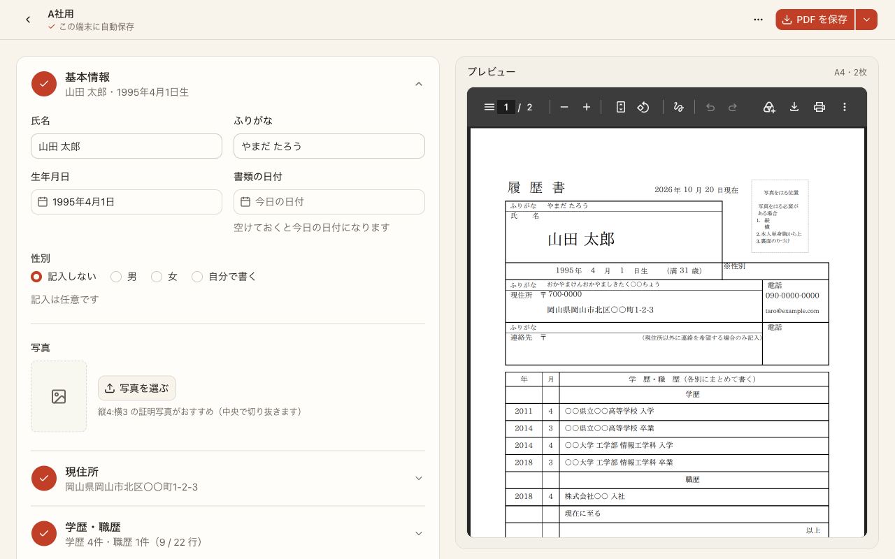
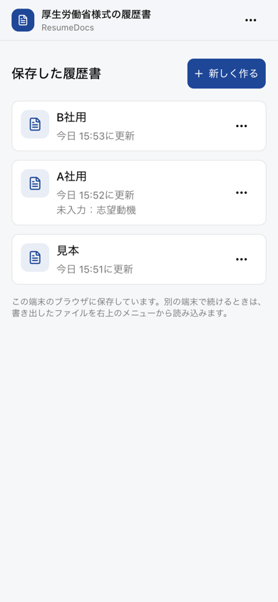
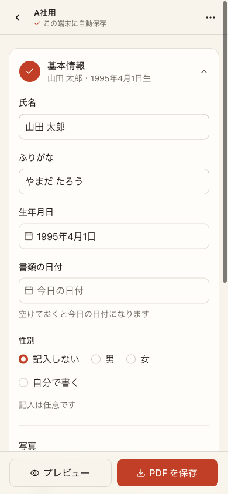
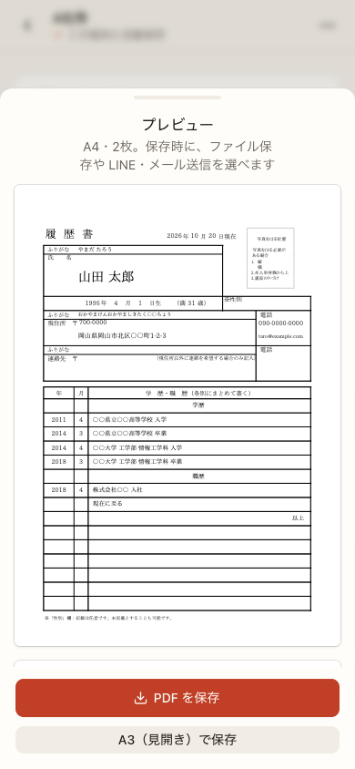

# career-hub

厚生労働省の「履歴書様式例」どおりの履歴書を、ブラウザで入力するだけで PDF にできるツールです。

**[ブラウザで使う](https://career-hub-one-dusky.vercel.app)**（無料・登録不要。入力内容はブラウザの中だけに保存し、どこにも送信しません）



<p align="center">
  
  
  
</p>

## 特徴

- 厚生労働省が配布している PDF をそのまま下地にして、記入内容だけを重ねます。罫線も見出しも描き直していないので、様式は公式と変わりません。罫線の位置が公式 PDF と 0.01pt（約0.004mm）以内で一致することは、`check_form.py` で確かめられます
- 入力からプレビュー、PDF の保存まで、スマホだけでできます。保存すると共有メニューが開くので、そのままファイルに保存したり、LINE やメールで送ったりできます
- 履歴書はいくつでも保存できます。応募先ごとに複製して、志望動機だけ書き換える使い方を想定しています
- 郵便番号と電話番号にはハイフンが自動で入り（電話番号は国番号も選べます）、メールアドレスは gmail.com などの候補から選べます。学歴・職歴・資格は、年月の順に自動で並びます
- 長い文章は、欄に収まるまで文字を小さくします。行数が様式を超えたときは知らせるだけで、勝手に切り捨てることはありません
- サーバーを持たない静的なページなので、入力内容も写真も外には送られません
- A4（2枚）と A3（見開き1枚）のどちらでも保存でき、顔写真も入れられます

## 使い方

1. [career-hub](https://career-hub-one-dusky.vercel.app) を開いて「新しく作る」を押す（試すだけなら「見本で試す」）
2. 基本情報・現住所・学歴・職歴などを入力する。パソコンでは画面の右側、スマホでは「プレビュー」で仕上がりを確認できる
3. 「PDF を保存」を押す

知っておいてほしいこと：

- 入力内容は、そのブラウザの中に保存されます。ブラウザのデータを消すと履歴書も消えるので、残しておきたいものは、編集画面のメニューにある「データを書き出す」でファイルに保存してください。保存したファイルは、別の端末でも一覧のメニューから読み込めます
- 作れるのは履歴書だけです。職務経歴書は、下の「コマンド版」で作れます
- 写真は JPEG か PNG を使ってください（Chrome では iPhone の HEIC 形式を読めません）
- 初回だけ、PDF 用のフォント（約 7.8MB）の読み込みに少し時間がかかります

## コマンド版（職務経歴書も作れる）

経歴を TOML ファイル1つにまとめておくと、履歴書（A4・A3）と職務経歴書を PDF で出力します。職歴は、履歴書の学歴・職歴欄と職務経歴書の両方に入ります。必要なのは Python 3.11 以上と Google Chrome だけです（pip install は不要）。


```sh
git clone https://github.com/6igtree/career-hub.git
cd career-hub
python3 build.py    # career.toml がなければサンプルで生成する
```

自分の経歴で作るときは、サンプルをコピーして編集します。`career.toml` は `.gitignore` に入っているので、うっかりコミットされません。

```sh
cp career.example.toml career.toml
# career.toml を編集（書き方はファイル内のコメントを参照）
python3 build.py
```

`out/` に次の3つができます（macOS では生成後に開きます）。

- `履歴書.pdf`：A4 版（2枚）
- `履歴書_A3.pdf`：A3 版（見開き1枚）
- `職務経歴書.pdf`

Chrome が見つからないときは、環境変数 `CHROME` に実行ファイルのパスを指定してください。

### 顔写真

`career.toml` の `[profile]` にある `photo` に画像のパスを書くと、写真欄に入ります。

```toml
photo = "photo.jpg"   # career.toml からの相対パス
```

- 写真欄いっぱいに表示し、縦横比が合わない分は中央で切り取る。縦4:横3 の証明写真データなら、ほぼそのまま収まる
- macOS では、iPhone の HEIC もそのまま使える。スマホの大きな写真は長辺 1200px に縮めて埋め込むので、PDF は数百 KB に収まる
- macOS 以外では JPEG か PNG を使う（縮小はしないので、大きな写真は先に縮めておく）
- `photo.*` は `.gitignore` に入れてあるので、写真がコミットされることはない

## 様式の決まりに合わせていること

ブラウザ版とコマンド版で共通です。

- 様式にメール欄がないので、メールアドレスは電話欄の下に入れる
- 連絡先欄は、現住所以外に連絡を希望する場合だけ書く（様式の注記どおり）
- 性別は任意。空なら空欄のまま
- 学歴・職歴は22行、免許・資格は6行、本人希望は4行まで
- 公式 PDF の写真欄には「縦／横」の寸法の数字が入っていない。下地は公式のままなので、出力にも入らない

## 開発

### ブラウザ版

`web/` にあります（Next.js と shadcn/ui で作成）。入力内容を厚生労働省の公式 PDF に直接書き込みます。文字を置く位置は、コマンド版と共通の `form/layout.json` を使います。

```sh
cd web
npm install
npm run dev     # http://localhost:3000 を開く
```

`npm run build` で、サーバーのいらない静的なページが `web/out/` に書き出されます。

### 様式の検証

```sh
brew install poppler   # 初回だけ
python3 check_form.py
```

コマンド版でサンプルから作った履歴書の罫線の座標を、公式 PDF と比べます。Chrome は PDF 化のときにページをわずかに縮める（A4 で約0.01%、A3 で約0.07%）ので、その分を `style.css` の `.cal` で打ち消しています。Chrome の更新でずれが出たら、このチェックで分かります。

コマンド版の動作を確認しているのは macOS + Google Chrome 155 です。ほかの OS でも動くはずですが未確認なので、使う前に `check_form.py` で確かめてください。

## ライセンス

コードは [MIT License](LICENSE) です。`form/` の様式ファイルは厚生労働省の著作物で、公共データ利用規約（第1.0版）に従って利用しています。

出典：厚生労働省「厚生労働省履歴書様式例」（[ハローワークインターネットサービス](https://www.hellowork.mhlw.go.jp/member/career_doc01.html)）、[公共データ利用規約（第1.0版）](https://www.digital.go.jp/resources/open_data/public_data_license_v1.0)

- `form/kouroushourirekisho*.pdf` は公式の配布ファイルのまま
- `form/*.svg` は上記の PDF を career-hub が加工して作成した（`pdftocairo -svg` で変換し、Chrome が整数 px に丸めて拡大しないよう、ルート要素の `width`・`height`・`viewBox` だけを A4 は 794×1123px、A3 は 1588×1123px に広げた。描画内容の座標は変えていない）

`web/public/fonts/ipaexm.ttf` は IPAex明朝で、IPAフォントライセンス v1.0 に従って同梱しています（ライセンス文は同じフォルダ）。

本ツールは、厚生労働省およびハローワークとは関係のない非公式のツールです。
