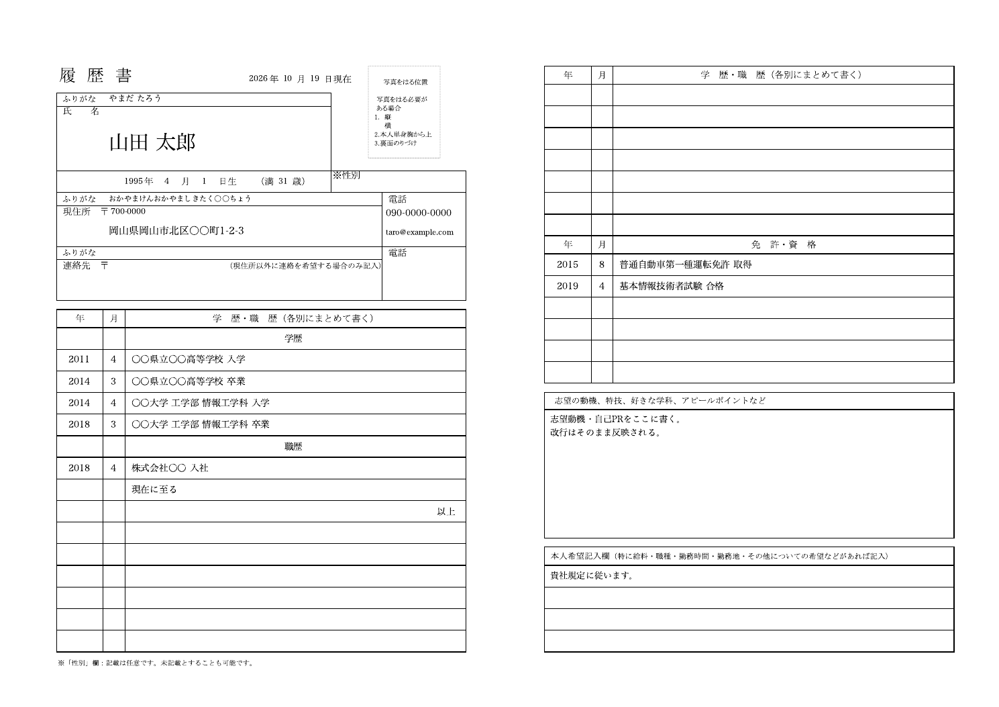

# career-hub

経歴を1つのファイルに書いておくと、**厚生労働省履歴書様式例どおりの履歴書**と職務経歴書を PDF で出力するツールです。



## 特徴

- 厚生労働省の公式 PDF をそのまま下地にして、記入内容だけを重ねる。罫線も見出しも描き直していないので、様式は公式と同じ
- 罫線の位置が公式 PDF と 0.01pt 以内で一致することを、`check_form.py` で確かめられる
- A4（2枚）と A3（見開き1枚）の両方を出力する
- 経歴は TOML ファイル1つで管理する。職歴は、履歴書の学歴・職歴欄と職務経歴書の両方に入る
- 欄からはみ出す文字は自動で縮める。行数が様式を超えるときはエラーで止まり、勝手に切り捨てない
- 必要なのは Python 3.11 以上と Google Chrome だけ（pip install は不要）

## 使い方

```sh
git clone https://github.com/6igtree/career-hub.git
cd career-hub
python3 build.py    # career.toml がなければサンプルで生成する
```

自分の経歴で作るときは、サンプルをコピーして編集します。`career.toml` は `.gitignore` に入っているので、うっかりコミットされません。

```sh
cp career.example.toml career.toml
# career.toml を編集（書き方はファイル内のコメントを参照）
python3 build.py
```

`out/` に次の3つができます（macOS では生成後に開きます）。

- `履歴書.pdf`：A4 版（2枚）
- `履歴書_A3.pdf`：A3 版（見開き1枚）
- `職務経歴書.pdf`

Chrome が見つからないときは、環境変数 `CHROME` に実行ファイルのパスを指定してください。

## 様式の決まりに合わせていること

- 様式にメール欄がないので、メールアドレスは電話欄の下に入れる
- 連絡先欄は、現住所以外に連絡を希望する場合だけ書く（様式の注記どおり）
- 性別は任意。空なら空欄のまま
- 学歴・職歴は22行、免許・資格は6行、本人希望は4行まで
- 公式 PDF の写真欄には「縦／横」の寸法の数字が入っていない。下地は公式のままなので、出力にも入らない

## 様式の検証

```sh
brew install poppler   # 初回だけ
python3 check_form.py
```

サンプルから作った履歴書の罫線の座標を、公式 PDF と比べます。Chrome は PDF 化のときにページをわずかに縮める（A4 で約0.01%、A3 で約0.07%）ので、その分を `style.css` の `.cal` で打ち消しています。Chrome の更新でずれが出たら、このチェックで分かります。

動作を確認しているのは macOS + Google Chrome 155 です。ほかの OS でも動くはずですが未確認なので、使う前に `check_form.py` で確かめてください。

## ライセンス

コードは [MIT License](LICENSE) です。`form/` の様式ファイルは厚生労働省の著作物で、公共データ利用規約（第1.0版）に従って利用しています。

出典：厚生労働省「厚生労働省履歴書様式例」（[ハローワークインターネットサービス](https://www.hellowork.mhlw.go.jp/member/career_doc01.html)）、[公共データ利用規約（第1.0版）](https://www.digital.go.jp/resources/open_data/public_data_license_v1.0)

- `form/kouroushourirekisho*.pdf` は公式の配布ファイルのまま
- `form/*.svg` は上記の PDF を career-hub が加工して作成した（`pdftocairo -svg` で変換し、Chrome が整数 px に丸めて拡大しないよう、ルート要素の `width`・`height`・`viewBox` だけを A4 は 794×1123px、A3 は 1588×1123px に広げた。描画内容の座標は変えていない）

本ツールは、厚生労働省およびハローワークとは関係のない非公式のツールです。
